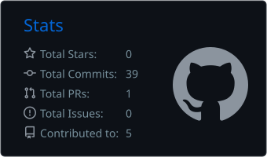
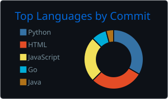

<h1 align="center">Hi, I'm Vi</h1>

  Software Engineer · Backend

  
  
  
  

---

## About

Software engineering intern at a card payment acquirer, working with **Go** and **AWS**. I come from a financial operations background (reconciliation, accounts payable and receivable), so I build software with the business problem in mind.

## Stack

  

## GitHub Stats

  
  

## Contact

[LinkedIn](www.linkedin.com/in/vitória-felix-0b10212b2) · [Email](mailto:vitoriafelixp@gmail.com)

